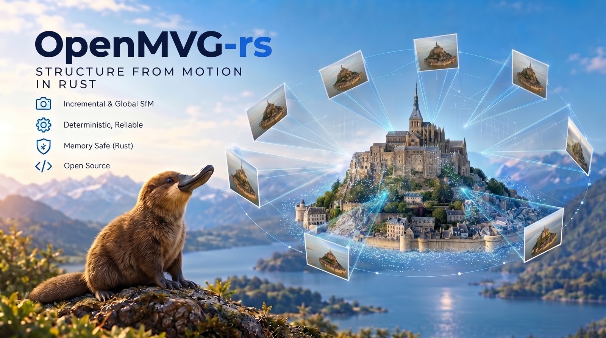

# OpenMVG-rs



[](https://github.com/openMVG/openmvg-rs/actions/workflows/ci.yml)
[](#license)
[](Cargo.toml)
[](https://discord.gg/Hp4nnP4Bkv)

A Rust-native computer vision toolkit for Multiple View Geometry and Structure from Motion (SfM):
from photos of a scene taken at different viewpoints, it recovers where each camera stood and a
3D point cloud of the scene. Use it from Python, from the command line, or as a Rust library;
results export to PLY and COLMAP.

- **Incremental and Global SfM**: Incremental adds images one at a time; Global solves all their
  poses at once.
- **Deterministic**: the same images and seed give the same reconstruction at every thread count.
- **Memory safe**: every library crate forbids `unsafe` code, and the default build has no native
  dependency.
- **Open source**: dual-licensed under MIT and Apache-2.0.

## Quick start

Make a new folder and download a small example dataset, 11 photographs of Sceaux Castle:

```bash
mkdir sceaux-demo
cd sceaux-demo
git clone https://github.com/openMVG/ImageDataset_SceauxCastle
```

From Python, make this folder a [uv](https://docs.astral.sh/uv/) project and add the package:

```bash
uv init --bare --python 3.12
uv add openmvg-rs
```

Save this script as `sceaux.py` in the same folder:

```python
import openmvg_rs

scene = openmvg_rs.reconstruct("ImageDataset_SceauxCastle/images")
print(scene)  # <openmvg_rs.Reconstruction engine='incremental' registered=11/11 points=...>
scene.write_ply("sceaux.ply")
```

Then run it:

```bash
uv run sceaux.py
```

With pip instead, inside a virtual environment (Python 3.11 or newer):
`python -m pip install openmvg-rs`, then `python sceaux.py`. Open `sceaux.ply` in a point-cloud
viewer such as MeshLab or CloudCompare. The [Python guide](bindings/python/README.md) covers
reading the results as NumPy arrays, COLMAP export, the other options, and getting good
results.

From the command line, the `openmvg-cli` package installs the `openmvg-sfm` command:

```bash
cargo install openmvg-cli
# writes ImageDataset_SceauxCastle/sfm_output/reconstruction.ply
openmvg-sfm ImageDataset_SceauxCastle
```

`openmvg-sfm --help` lists the engines, camera models, and outputs, and
`cargo install openmvg-cli --features tui` adds `openmvg-sfm-configure`, which groups the images
into cameras interactively; see the
[`openmvg-cli` README](crates/openmvg-cli/README.md).

From Rust, use the library through the umbrella crate, which re-exports every layer:

```toml
[dependencies]
openmvg = { version = "0.1", features = ["sfm-image-io", "io"] }
```

Reconstruct a folder of images, then save the points and cameras as a PLY point cloud and as
a COLMAP model:

```rust,no_run
use openmvg::io::write_colmap;
use openmvg::sfm::{Dataset, Incremental};

fn main() -> Result<(), Box<dyn std::error::Error>> {
    let dataset = Dataset::from_dir("ImageDataset_SceauxCastle/images")?;
    let output = Incremental::default().run(&dataset)?;
    let reconstruction = output.reconstruction();
    println!("{} views registered", reconstruction.registered_view_count());
    reconstruction.write_ply("scene.ply")?;
    write_colmap(reconstruction, "colmap")?;
    Ok(())
}
```

## Crates

| Crate | Description | Release posture |
|-------|-------------|-----------------|
| `openmvg` | Umbrella crate re-exporting `core`, `geometry`, `features`, `sfm`, and `io` | Recommended entry point |
| `openmvg-core` | Camera models, IDs, graphs, poses, typed units, and deterministic seeds | Stable foundation |
| `openmvg-geometry` | F/E/H, pose, alignment, triangulation, averaging, and robust estimation | Stable numerical library |
| `openmvg-features` | Detection, description, matching, and tracking | Stable feature library |
| `openmvg-sfm` | Dataset, prepared ViewGraph, Incremental and Global reconstruction, and reports | Stable workflow library (umbrella feature `sfm`) |
| `openmvg-ba` | Checked bundle adjustment (BA) and its nonlinear numerical primitives | Stable numerical library |
| `openmvg-io` | Reader, writer, and validator of the OMVG community format (manifest plus Parquet tables) | Draft format (umbrella feature `io`) |
| `openmvg-cli` | The `openmvg-sfm` command, and the `openmvg-sfm-configure` terminal app behind `tui` | Command-line programs (source install) |

The optional Rerun visualization adapter, `openmvg-rerun`, is built separately; see
[DEVELOPER.md](DEVELOPER.md). The [reproducibility contract](docs/REPRODUCIBILITY.md) defines what
identical scientific output means and how RNG protocol changes are accepted.

## Learn

Each crate's documentation opens with what the crate is for, a runnable example, and a
learning path through its modules; the algorithm pages explain each method with a diagram,
its failure modes and its references. Read them in pipeline order:

1. [`openmvg`](crates/openmvg/README.md): which module serves which goal, and how the crates
   fit together.
2. [`openmvg-core`](crates/openmvg-core/README.md): cameras, poses, and the conventions every
   crate shares.
3. [`openmvg-features`](crates/openmvg-features/README.md): keypoints, descriptors, matches and
   tracks.
4. [`openmvg-geometry`](crates/openmvg-geometry/README.md): from matches to poses and 3D points.
5. [`openmvg-sfm`](crates/openmvg-sfm/README.md): the Incremental and Global engines.
6. [`openmvg-ba`](crates/openmvg-ba/README.md) and [`openmvg-io`](crates/openmvg-io/README.md):
   bundle adjustment, and storing and sharing results.

To browse the documentation locally:

```bash
pixi run cargo doc --no-deps --features openmvg/full --open
```

## Building from source

Development uses [Pixi](https://pixi.sh) to provide the pinned Rust toolchain
and native dependencies.

```bash
# Clone the repository
git clone https://github.com/openMVG/openmvg-rs
cd openmvg-rs

# Build all crates
pixi run cargo build --workspace

# Run tests
pixi run cargo test --workspace

# Check documentation
pixi run cargo doc --workspace --no-deps
```

## Python

The `openmvg-rs` package (`import openmvg_rs`) runs the same reconstruction from Python. Its
[README](bindings/python/README.md) lists the platforms with wheels, how to build it from source,
and the whole API.

## Documentation

The [documentation index](docs/README.md) links to crate guides, the OMVG community format,
architecture, validation and contributor instructions.

## AI and coding agents

Parts of this project were developed with assistance from large language models,
especially for complex math, optimization, and testing.

## Citation

If you use OpenMVG-rs in a publication, please cite it together with the
original OpenMVG paper. [CITATION.cff](CITATION.cff) holds the same metadata,
and GitHub turns it into a "Cite this repository" entry.

```bibtex
@software{openmvg_rs,
  title   = {{OpenMVG-rs}: Multiple View Geometry and Structure from Motion in Rust},
  author  = {Moulon, Pierre and {OpenMVG-rs contributors}},
  year    = {2026},
  version = {0.1.0},
  url     = {https://github.com/openMVG/openmvg-rs}
}

@inproceedings{moulon2016openmvg,
  title     = {{OpenMVG}: Open Multiple View Geometry},
  author    = {Moulon, Pierre and Monasse, Pascal and Perrot, Romuald and Marlet, Renaud},
  booktitle = {International Workshop on Reproducible Research in Pattern Recognition (RRPR)},
  pages     = {60--74},
  year      = {2016}
}
```

Please also cite the papers behind the algorithms you rely on; each solver's
module documentation lists its provenance.

## License

Licensed under either of the [Apache License, Version 2.0](LICENSE-APACHE) or the
[MIT license](LICENSE-MIT) at your option.

## Contributing

Contributions are welcome. Read the [contributing guidelines](CONTRIBUTING.md)
before opening a pull request.
