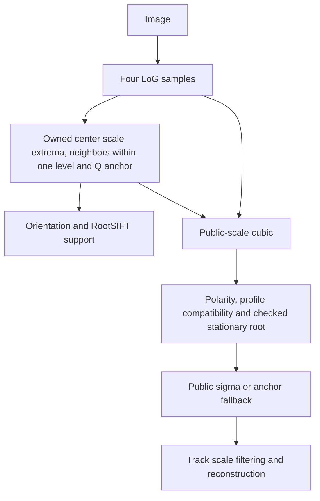

# ALP generated tables

Julia 1.12.6 is required. The project uses Julia's standard libraries and
single-threaded BLAS. Generate or check the artifacts from this directory:

```bash
julia --startup-file=no --project=. generate_alp_tables.jl
julia --startup-file=no --project=. generate_alp_tables.jl --check
julia --startup-file=no --project=. generate_alp_geometry_tables.jl --check
```

`generate_alp_tables.jl` writes `../../src/extraction/alp/tables.rs` and
`alp_table_report.md` from two models.

## Scale response model

`scale_model.jl` maps four finite LoG responses to cubic coefficients in physical
sigma. It minimizes equal-weight Gaussian and sinusoidal response error, with
each profile normalized to unit integrated response energy. Bases 0.5/1.6 have
equal weight; characteristic scale is uniform in log sigma over the accepted
window `[1.9027314f0,4.1498866f0]`. Gaussian phase covers `[-0.5,0.5]²`, and wave
direction covers `[0,π/2]` with frequency `√2/σ`.

For four input responses `r`, target profile `R(s)`, and cubic basis `v(s)`,
the constrained objective is

```text
E[⟨(v(s)ᵀ T r - R(s))²⟩log(s) / ⟨R(s)²⟩log(s)],
v(s) = [s³,s²,s,1],  T·1 = [0,0,0,1]ᵀ.
```

The expectation gives equal weight to both families. Wave inputs are
`exp(-b²k²/2)·cos(k(cosθ x+sinθ y))`.

The quadrature uses 32 characteristic scales, 3 points per Gaussian phase
coordinate, and 8 wave directions. Profile integration covers the full four-node
interval, split at finite Gaussian radius transitions with 12 points per piece.
The constant-response constraint `T·1=[0,0,0,1]ᵀ` is eliminated with orthonormal
contrasts. A 12-variable QR solve uses a centered sigma basis; the result is
converted to physical-sigma coefficients and Float32.

The model evaluates Float32 Gaussian coefficients and finite Laplacian responses
with vertical then horizontal convolution. Runtime image filtering uses
horizontal then vertical passes; these orders can differ by rounding.
Normalization, quadrature, and QR use Float64. All 16 fitted weights are
serialized. Rust uses the first three quantized weights per row with three
sample differences and the last sample as its constant reference. Its effective
fourth column follows the constant constraint; the stored fourth entry records
the independently rounded fit. Generated Julia coefficient vectors check the
centered arithmetic in Rust.

## Detector scale and spatial competition

At each pixel the scale envelope compares the raw endpoint responses with typed
stationary values of the physical-sigma cubic. Accepted stationary scales must
lie in `[1.9027314,4.1498866]`, have matching finite curvature and exceed the
response threshold. The octave owns the extremum only when an interior level
carries its strongest sample of that sign, which places a log-symmetric profile
between `√(σ0σ1)` and `√(σ2σ3)` and leaves the shared levels to one octave. The
center stationary value then competes with all eight neighbor cubics over one
level step around its scale, `[σ/√2, σ·√2]` clipped to the sampled levels: the
band ends and each neighbor's typed stationary point inside the band. This is
the continuous counterpart of SIFT's comparison with adjacent levels; neither
rule changes a generated table. The spatial fit keeps the selected sigma fixed.
Finite-difference and Q spatial Hessians must have the extremum's sign; the
finite-difference Hessian also rejects poorly localized edge responses.

## Spatial model

`kernel_model.jl` derives `(8/5)·√2^k` sample nodes and five spatial Q stencils
per node from analytic scale-normalized LoG kernels. It uses a 19×19 integer
kernel lattice, nine integer shifts, and a 21×21 offset grid. Two QR solves fit
the quadratic coefficient kernels and project them onto the nine samples.
Square-domain symmetries are imposed at 192-bit precision, followed by
six-decimal rounding and Float32 conversion. Four masks specify exact-zero
signs for serialization.

## Public scale and descriptor support

`generate_alp_geometry_tables.jl` writes `geometry_tables.rs` and
`alp_geometry_report.md` from the self-contained finite Gaussian model in
`alp_geometry_model.jl`. The 567 known-scale value/slope cases and 41 independent
common-kernel variance probes are generated. Native bases 0.5/1.6 and an actual
first transition have equal weight. The constrained 12-variable centered QR
uses `λ=(1/4)/ln(2)^4` and declared regularizer `q=2/(12·255²)`; its covariance
preference is not an exact camera noise model.

The native modeled input has unit peak and width `sqrt(σ²+base²)`.
Filtering uses vertical then horizontal Float32 paired sums, while runtime
uses horizontal then vertical passes. Fit normalization and QR use Float64.
Centered sample differences preserve flat-input fallback after quantization.
A four-point centered line fit of `sqrt(s²/abs(r))` against `s²` tests Gaussian
profile compatibility. Its Float32 residual envelope is generated from the same
567 cases. Compatible profiles use damping `4/5`, unsupported profiles `2/5`,
with a linear four-times margin. The fallback Newton move is clipped to `1/40`
octave. Compatibility blends that fallback with the model's signed stationary
root. The root uses a non-cancelling quadratic formula; it must stay inside the
model domain, preserve curvature polarity, reduce the derivative, and improve
the polynomial response relative to the fallback. The statistic is not a
Gaussian probability; inverse square roots, finite filtering and additive
noise affect it.
All grids, target equations, supports, precision and policy are in
`alp_geometry_report.md`.



Orientation and descriptor support use the detector anchor sigma; descriptor
gradients are interpolated between sampled Gaussian levels in log sigma.

RootSIFT-f32 and RootSIFT-u8 are the supported descriptor lanes. The complete
target definitions, precision conventions, checksums, and references are in
`alp_table_report.md`.
